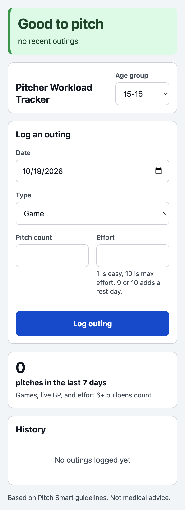
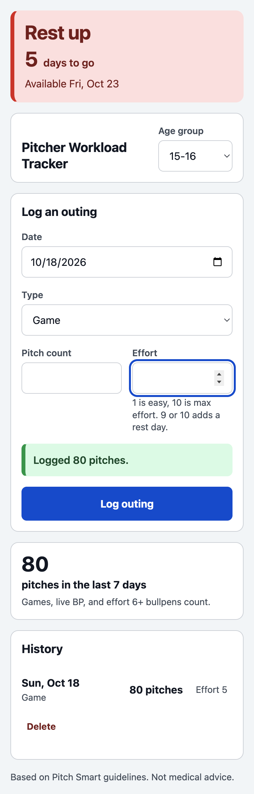

# Pitcher Workload Tracker

Small, local-first tracker for youth baseball pitchers. Log an outing, choose
an age group, and get a quick answer about whether the pitcher is ready to
throw again.

## Live app

https://sujay709.github.io/pitcher-tracker/

## Screenshots

The screenshots below are phone-sized captures from the app.






## Run it locally

This is a static site, but it uses ES modules and `fetch`, so open it through a
local HTTP server rather than double-clicking `index.html`.

```sh
python3 -m http.server 8000
```

Then open http://localhost:8000.

## Install and export

On a supported phone browser, use “Add to Home Screen” to install the tracker.
The app includes a manifest and icons, but deliberately does not use a service
worker or offline cache.

The installed iPhone home-screen app has storage separate from Safari. Outings
logged in Safari will not appear in the installed app, so pick one place to use
for tracking. The app follows the device light/dark preference automatically.

Use **Export data** below the history to download a JSON backup of the outings
and their IDs. The export is wrapped as a versioned object (`version: 1`) so
future schema changes can be handled safely. Use **Import JSON** to restore a
backup; imports also accept older bare-array exports. Invalid rows and outings
whose IDs already exist are skipped and summarized after import.

For a backup round trip, export the data, clear this site's storage, then use
**Import JSON** to restore it. Confirm that history, status, and weekly totals
match the original. The import rejects corrupted, empty, non-JSON, and files
larger than 1 MB.

## How the rest logic works

The app groups outings by date and only counts:

- Games
- Live BP
- Bullpens with effort 6 or higher

For each day that counts, it uses the pitch-count rest bands for the selected
age group. The latest resulting availability date wins. A pitcher is marked
green when that date has passed, yellow when it is within two days, and red
otherwise. The weekly total uses the same “counts toward rest” rule and covers
today plus the previous six days.

The pitch-count bands come from [Pitch Smart’s published pitch-count
guidelines](https://pitchsmart.com/pitch-count-guidelines). I checked the
source on 2026-10-09; the copy used by the app is in
[`data/guidelines.json`](data/guidelines.json).


## Limitations

- Outings and the selected age group live in this browser’s `localStorage`.
  They are per device and per browser, so a phone and a laptop do not share
  data.
- Browsers can clear site storage. Safari/WebKit treats website storage as
  best-effort and documents eviction when an origin has not had user
  interaction for a while, as well as eviction under storage pressure. Safari
  private browsing is ephemeral too. A long gap or private browsing session
  can therefore wipe the history. See
  [WebKit’s storage policy](https://webkit.org/blog/14403/updates-to-storage-policy/)
  and [tracking-prevention notes](https://webkit.org/tracking-prevention/).
- Exported backups are not encrypted by this app. Treat them like any other
  personal health-related record.
- This is guidance based on published recommendations, not medical advice.

## Disclaimer

This tool is not medical advice. A coach, parent, athlete, or clinician should
use judgment and the pitcher’s actual condition, not this page alone, when
deciding whether to throw.
